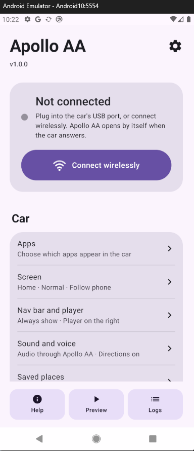
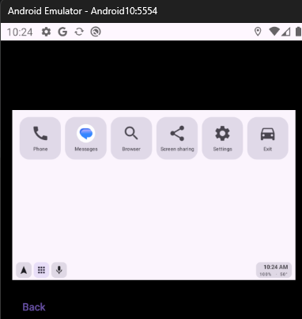
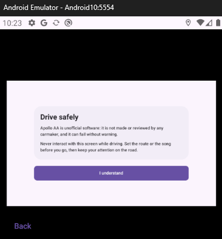
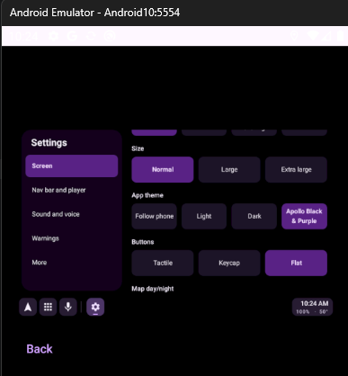
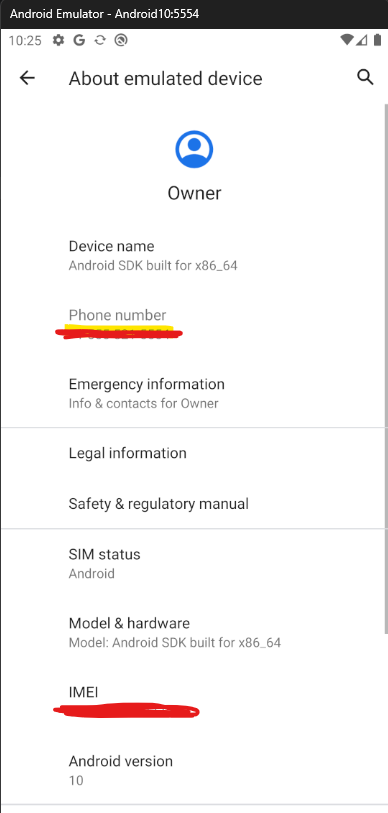
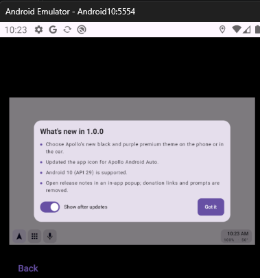

<p align="center">
  
</p>

<h1 align="center">Apollo AA</h1>

<p align="center">Your Android phone, connected to your car's Android Auto screen.</p>

<p align="center">
  <a href="https://github.com/Apollo-40418/Apollo-AA/releases/latest">
    
  </a>
  <a href="https://apps.obtainium.imranr.dev/redirect?r=obtainium://add/https://github.com/Apollo-40418/Apollo-AA">
    
  </a>
  
</p>

<p align="center">
  
  <br>
  <sub>Personalize the app drawer with an animated GIF background.</sub>
</p>

Apollo AA is a fork of Gearslip that lets compatible Android apps show their car screens
without Google's Android Auto app.

## Features

### Apollo AA customizations

- Android 10 (API 29) and newer are supported. Wireless auto-connect requires Android 12 or later.
- Apollo AA branding and app icon, with an in-app **What's New** popup.
- A Help popup lists cars reported to work or not work with Apollo AA.
- Optional ADB commands show whether each permission is **ADB GRANTED** or **ADB NOT GRANTED**.
- The app drawer keeps Tactile, Flat, and Keycap styles, and adds Transparent Border, Round, and Square.
- Choose named colors for the app drawer shapes, including the original button styles.
- Set a photo or animated GIF as the app drawer background. These customizations do not change the main menu.

### Android Auto essentials

- Connect to compatible head units over USB or wireless.
- Use car-ready map, music, and messaging apps, plus built-in calling and voice controls.

## Screenshots

| Home screen | App drawer |
|---|---|
|  |  |

| Car preview | Appearance settings |
|---|---|
|  |  |

| Running on Android 10 | Android 10 compatibility |
|---|---|
|  |  |

## Download and connect

1. Get the latest APK from [GitHub Releases](https://github.com/Apollo-40418/Apollo-AA/releases/latest)
   or install through [Obtainium](https://apps.obtainium.imranr.dev/redirect?r=obtainium://add/https://github.com/Apollo-40418/Apollo-AA).
2. Open Apollo AA and complete the on-screen setup.
3. Connect by USB, or pair your phone with the car over Bluetooth and choose **Connect wirelessly**.

Wireless auto-connect requires Android 12 or newer. On Android 10 and 11, start a wireless
connection from Apollo AA. Some newer cars require their own Android Auto certificate; see the
[confirmed car list](CARS.md).

> Set up and test while parked. Compatibility varies by phone and car; keep another way to navigate.

## Build

```sh
./gradlew :gearslip:assembleDebug
```

The debug APK is written to `build/Apollo_Android_Auto-debug.apk`. Production release APKs are
available on the [releases page](https://github.com/Apollo-40418/Apollo-AA/releases).

## Privacy and project

Optional car-compatibility reports are off by default and can be controlled in Settings.
Questions and bug reports are welcome in
[GitHub Discussions](https://github.com/Apollo-40418/Apollo-AA/discussions).

Apollo AA is based on [Gearslip](https://github.com/Seb3thehacker/Gearslip) and is licensed under
AGPL-3.0; see [LICENSE](LICENSE) and [NOTICE](NOTICE.md). Android and Android Auto are trademarks
of Google LLC; Apollo AA is not affiliated with Google.

<details>
  <summary>Verify the production APK signature</summary>

  - Package: `com.apollo.app_aa`
  - Certificate SHA-256: `CB:C4:DD:76:2B:E6:8E:67:13:E0:AD:CE:2B:15:A6:EF:69:E0:68:87:E9:8E:64:F9:C8:F0:2D:DF:A1:86:98:80`
</details>
